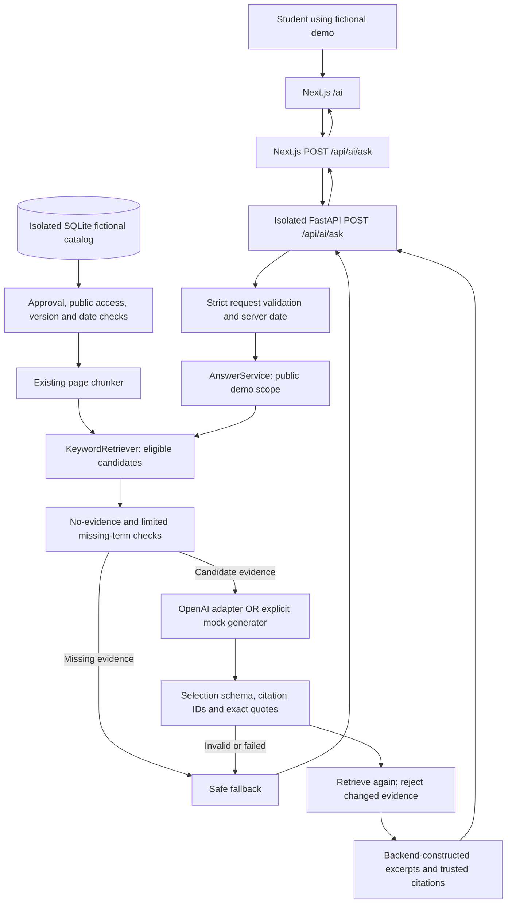

# CampusPilot — Complete System Inventory and Architecture Status

- **Inventory date:** October 26, 2026, Asia/Manila
- **Consultation deadline supplied by the team:** October 28, 2026
- **Repository:** `dev-cali/Campus-Pilot`
- **Inspected checkout:** `C:/CampusPilot/Campus-Pilot`
- **Branch:** `feature/s3-03-frontend-ai-integration`
- **HEAD:** `1d604844f617117f6de7d9914b1d654495ace412` (S3-02 checkpoint)

This report describes the working tree, including uncommitted S3-03 files. It is
not a claim that those files are merged, deployed, or available to teammates.
Only this report was authored during this inventory task. Existing changes were
preserved. No production database, paid model, or deployment was contacted.

## Evidence legend and inspection boundary

- **Verified from source:** observed in current files, manifests, installed package
  metadata, or local Git commands during this inventory.
- **Verified by test:** a check actually executed during this inventory; its scope
  is stated. Passing tests are not a complete security or correctness guarantee.
- **Previously reported:** historical command/browser evidence or an earlier report;
  it was not rerun for this inventory.
- **Planned:** a proposed design or future task, not implemented behavior.
- **Unverified:** insufficient evidence to claim operation, deployment, or success.

The normal Windows sandbox launcher reproduced `CreateProcessAsUserW failed: 5`.
Approved outside-sandbox execution enabled read-only inspection and offline checks;
Windows security settings were not changed. No root AGENTS.md exists in this
checkout; [frontend instructions](../frontend/AGENTS.md) are present and were read.
The relevant installed Next.js guides had been read during S3-03 implementation.
No frontend application code is changed by this report.

Remote-tracking refs below are local cached information: no fetch was performed.
Production build/browser evidence is historical, deliberately separated from fresh
tests. A build was not rerun because this task authorizes only a new report and a
build generates project output. No running server's status was inferred from an
open browser tab.

## 1. Project overview

**Previously reported project intent:** CampusPilot is a university information
hub intended to help students find understandable, source-backed answers. Future
administrators/content owners would manage approved resources. The five-person
team is Marc (AI Engineering), Brian (Backend/API), Cassie (DevOps), Josiah
(Frontend), and John Paul (full-stack/department integration).

**Verified from source:** the current academic demo uses invented **Demo Campus
University** records. It provides a question interface, local document eligibility,
storage and retrieval, a configurable model adapter, and checked source excerpts
with citations. A separate older application displays departments and contains an
AI connection-test endpoint. These paths are not the same deployed application.

AI is intended to interpret questions and select useful evidence. RAG means
**retrieval-augmented generation**: retrieve passages before asking a model to
respond. Here the model selects exact excerpts; backend code constructs the final
answer. This is deliberately narrower than free-form university advice.

The current audience is students/developers/advisers evaluating a local prototype.
The UI says that the data is fictional and asks users not to enter private records.
No student account, production authentication, document-management CRUD workflow,
or complete policy-verification system is implemented in this demo.

**Privacy boundary:** fictional labels are not a detector for real private data.
The live adapter would send the entered question and selected public passages to
the provider. Do not use real student records. The default demo has no rate limits
or production access control and should remain on loopback.

## 2. Current technology stack

Unless noted otherwise, this table is **Verified from source**. Installed versions
were read from the active environment; a declaration in a manifest is distinguished
from an installed version.

| Technology | Purpose in simple English | Current implementation/status |
| --- | --- | --- |
| Python | Runs the backend and AI preparation logic | Project environment Python **3.13.14**; CI declares **3.11**. Local success does not prove CI-version compatibility. |
| FastAPI | Receives HTTP questions and returns typed responses | **0.162.0** installed/pinned in demo manifest; separate shared and isolated demo apps. |
| Pydantic | Checks expected fields and types | **2.14.1** installed/pinned; strict question/model-selection/answer schemas. |
| SQLAlchemy | Maps Python objects to database records | **2.1.6** installed/pinned; shared relational models and a separate SQLite demo adapter. |
| SQLite | Small local database stored in a file | Implemented demo persistence; tests use temporary files. No server or account required. |
| Supabase PostgreSQL | Intended shared hosted relational database | Shared SQLAlchemy models and Supabase-targeted connection configuration exist. Live health/schema are **Unverified**; AI demo does not use them. |
| Next.js | Web pages and server-side API forwarding | Manifest/lockfile declare **16.4.0**; installed **16.4.3**. App Router page and POST proxy implemented. |
| React | Interactive form, state, and rendered components | **19.3.0** declared and installed; React DOM **19.3.0** declared. |
| TypeScript | Checks frontend code types | **5.9.3** installed; manifest allows `^5`. |
| Node.js | Executes Next.js and frontend tests | **24.14.0** local; CI selects major **20**. |
| Tailwind/CSS | Frontend styling | Tailwind `^4` and `@tailwindcss/turbopack` `^4` declared; global theme plus scoped AI-page CSS module. |
| ESLint | Detects frontend coding issues | Manifest uses `^9`, plus Next ESLint config **16.4.0**; full lint currently fails on an existing homepage type. |
| OpenAI SDK | Calls the existing provider when explicitly configured | **3.37.0** installed/pinned; structured Chat Completions adapter. Genuine successful call **Unverified**. |
| HTTPX | HTTP client support used by API testing stack | **0.28.1** installed/pinned. |
| Uvicorn | Runs FastAPI locally | **0.54.0** installed/pinned. |
| Pinecone | Planned vector-search service | **Planned**, no client/index/query/upsert integration found. |
| Embedding model | Planned conversion from text to numerical vectors | **Missing** from the current execution path; keyword matching is used instead. |
| Render | Intended shared backend hosting | Homepage contains a Render departments URL. Availability/deployment configuration **Unverified** in this task. |
| Vercel | Intended frontend hosting | **Previously reported** project choice/checks; current deployment and S3-03 publication **Unverified**. |
| GitHub Actions | Runs checks on PRs | Workflow installs Python dependencies, runs offline unittest, and builds frontend. Hosted execution **Unverified**. |

[requirements-demo.txt](../requirements-demo.txt) pins the six direct demo packages,
not the complete transitive dependency graph. [Frontend package.json](../frontend/package.json)
also declares Node/React type packages. CI separately installs unpinned psycopg,
psycopg2-binary, python-dotenv, and Alembic for the legacy backend; this inventory
does not assert that those extras are installed locally. No extra agent framework
is used. The root [package.json](../package.json) declares a package named `20`;
that dependency is not a Node runtime setting and needs separate owner review.

## 3. Complete repository structure

**Verified from source:** application/source inventory below includes tracked files
and the eight existing untracked S3-03 files. `U` identifies those pre-existing
untracked files, `M` the pre-existing tracked modification. Generated directories
are described separately rather than expanding thousands of package files.

```text
Campus-Pilot/
├── .env.example                    # Tracked template; no values reproduced here
├── .gitignore                      # Ignores environment, caches, local demo DB
├── .github/workflows/ci.yml         # PR-to-main Python tests + frontend build
├── README.md                       # Currently only the project title
├── main.py                         # Shared/legacy FastAPI app
├── database.py                     # Shared SQLAlchemy models/configuration
├── alembic.ini                     # Shared migration configuration
├── alembic/
│   ├── env.py                      # Uses shared Base.metadata
│   ├── README
│   └── script.py.mako              # Revision template; no tracked revisions found
├── package.json                    # Root npm manifest, package named "20"
├── package-lock.json               # M: root package-name metadata addition
├── requirements-demo.txt           # Six pinned direct demo dependencies
├── ai/
│   ├── __init__.py
│   ├── document_processing.py      # Normalization + page chunking
│   ├── document_eligibility.py     # Fictional catalog and access/version checks
│   ├── demo_store.py               # Isolated SQLite records + prepared chunks
│   ├── local_retrieval.py          # KeywordRetriever and Evidence interface
│   ├── answer_service.py           # Orchestration, output checks, fallbacks
│   ├── llm_client.py               # Real OpenAI adapter; no call on import
│   └── demo_api.py                 # Isolated POST /api/ai/ask app
├── tests/
│   ├── test_document_processing.py # 19 tests
│   ├── test_document_eligibility.py# 25 tests
│   ├── test_demo_store.py          # 10 tests
│   ├── test_local_retrieval.py     # 8 tests
│   ├── test_answer_api.py          # 6 tests, including 14 evaluation subcases
│   ├── test_llm_client.py          # 3 tests
│   ├── frontend_demo_server.py     # U: explicit mock-only UI demo server
│   └── fixtures/
│       ├── sample_university_document.txt # Fictional S2 prose fixture
│       ├── fictional_documents.json      # Six Demo Campus records
│       └── ai_eval_cases.json             # 14 mocked acceptance scenarios
├── frontend/
│   ├── AGENTS.md                  # Requires installed Next.js guide inspection
│   ├── .gitignore
│   ├── README.md
│   ├── package.json
│   ├── package-lock.json
│   ├── next.config.ts             # Existing experimental/cache/Turbopack setup
│   ├── eslint.config.mjs
│   ├── tsconfig.json
│   ├── app/
│   │   ├── favicon.ico
│   │   ├── globals.css
│   │   ├── layout.tsx             # Shared fonts/layout; generic root metadata
│   │   ├── page.tsx               # Existing departments homepage
│   │   ├── ai/
│   │   │   ├── page.tsx           # U: /ai metadata and component entry point
│   │   │   ├── assistant.tsx      # U: interactive question/answer UI
│   │   │   └── assistant.module.css # U: isolated responsive styles
│   │   └── api/ai/ask/route.ts     # U: same-origin server-side proxy
│   ├── lib/ai-contract.ts         # U: shared frontend/proxy response validation
│   ├── tests/ai-proxy.test.mjs     # U: seven Node test-runner results
│   └── public/
│       ├── CampusPilot.html / CampusPilot.css # Static chat/design prototype
│       ├── campus-pilot.css         # Preserved legacy stylesheet
│       └── file.svg, globe.svg, next.svg, vercel.svg, window.svg
└── docs/
    ├── document_processing.md
    ├── offline_rag_architecture.md
    ├── rag_mvp.md
    ├── frontend_ai_integration.md  # U: two-terminal guide and S3-03 results
    └── CAMPUSPILOT_SYSTEM_STATUS.md # This new report
```

Ignored local runtime material includes `.venv/`, `node_modules/`, `.next/`, Python
caches, environment files under applicable ignore rules, and `.campuspilot-demo/`.
The default persistent database path is `.campuspilot-demo/fictional.sqlite3`.
The mock UI server uses a temporary database instead. Private configuration values
were not inventoried or copied.

Separate preserved branches contain the AI engineering status report
(`docs/ai-engineering-status`) and proposed guardrails (`docs/ai-guardrails-requirements`).
Those documents are not present as ordinary files in the current checkout. A
separate `docs/codex-instructions` branch contains root instructions work; it was
not merged or applied to this checkout by this inventory.

## 4. Implemented features

The entries in this section are **Verified from source**, with runtime limits noted.

### Frontend and API surfaces

| Surface | Behavior | Evidence |
| --- | --- | --- |
| Next.js `/` | Reads remote departments, shows loading/list/empty state; no AI form | [Homepage](../frontend/app/page.tsx) |
| Next.js `/ai` | Fictional notice, question field, character count, loading/disabled submit, answer/status/citation display | [AI page](../frontend/app/ai/page.tsx), [client component](../frontend/app/ai/assistant.tsx) |
| Static prototype | Separate category/chat HTML with empty API_URL and canned demo replies; not the integrated `/ai` route | [CampusPilot.html](../frontend/public/CampusPilot.html) |
| Next.js POST `/api/ai/ask` | Validates JSON, forwards only question to configured FastAPI origin, checks response shape/status; no direct model call | [Proxy](../frontend/app/api/ai/ask/route.ts) |
| Shared FastAPI GET `/` | Health message | [main.py](../main.py) |
| Shared FastAPI GET `/departments` | SQLAlchemy department query | [main.py](../main.py), [database.py](../database.py) |
| Shared FastAPI GET `/test-ai` | Fixed-prompt OpenAI connection test; not RAG; live execution unverified | [main.py](../main.py) |
| Isolated FastAPI POST `/api/ai/ask` | Strict input, answering service, typed results and safe status handling | [demo_api.py](../ai/demo_api.py) |
| Isolated FastAPI `/docs` | Framework-generated interactive endpoint documentation | [demo_api.py](../ai/demo_api.py) |

The homepage remains separate and has no link to `/ai`; open `/ai` explicitly.
The assistant includes a return-home link. Neither component replaces the shared
department feature. No document CRUD routes, student login UI, or authoritative
content-approval administrative workflow were found in these applications.

### Preparation, retrieval, and answer checks

| Component | Actual behavior | Main limitation |
| --- | --- | --- |
| [Processing](../ai/document_processing.py) | Normalize already-extracted text; split one page by paragraph/word/hard character boundaries; preserve metadata and offsets | No PDF/OCR extraction; character limit is not a token limit; prose layout can be lost |
| [Eligibility](../ai/document_eligibility.py) | Strict fictional metadata, allowed statuses/access, complete-catalog validation, explicit reference date, supersession checks | Trusts supplied catalog and permissions; cannot prove they are authoritative |
| [Store](../ai/demo_store.py) | Local SQLite records; transactionally replace fictional catalog/prepared chunks on seed; revalidate and rechunk before public retrieval | Separate demo schema; no production schema migration or persistent answer storage |
| [Retrieval](../ai/local_retrieval.py) | Case-folded Unicode word overlap over title/text, stop-word filtering, deterministic ranking; default top three, configurable one to five | No stemming/synonyms/vector embeddings; overlap is not answer sufficiency |
| [LLM adapter](../ai/llm_client.py) | OpenAI Chat Completions, JSON schema, no tools, bounded output, lazy environment configuration | Model/account support and successful real response unverified |
| [Answer service](../ai/answer_service.py) | Conservative scope signals; no-evidence fallback; validates selections and exact quotes; reconstructs citations; rereads evidence before release | No full semantic relevance, completeness, entailment, or conflict verifier |
| [Mock helper](../tests/frontend_demo_server.py) | Temporary database and deterministic selected passage with explicit MOCK label | Demonstrates integration only; not real AI reasoning |

`DocumentChunk` results retain document/page/source/title/version, per-page index,
text, and normalized offsets. The Python dataclass and shared SQLAlchemy class
with that name are different types. The index resets per page and is not a global
vector/citation identifier.

### Actual request and response contract

The request is exactly a JSON object containing `question`: a nonblank string of
at most 2,000 Unicode code points. Extra fields such as `is_staff` are rejected.

The model-facing schema is separate: `status` is `answered` or
`insufficient_evidence`, with `selections` containing `evidence_id` and exact `quote`.
For answered results the backend requires one to three selections, unique known
IDs, nonblank matching text, and version metadata. Fallback selections must be empty.

The student-facing response contains `status`, nonblank `answer`, `citations`, and
`fictional: true`. Each citation contains `evidence_id`, integer `document_id`,
`page_no`, `chunk_index`, `title`, `version`, and `source_reference`.

| Result | HTTP code | Display behavior |
| --- | --- | --- |
| answered | 200 | Backend-constructed source excerpts plus citations |
| insufficient_evidence | 200 | Evidence limitation; empty citations |
| denied | 403 | Neutral denial; empty citations |
| unavailable | 503 | Neutral temporary failure; empty citations |
| Invalid FastAPI request | 422 | Fixed validation detail, without echoing the input |
| Proxy cannot reach/validate backend | 502 | Neutral frontend connectivity/error message |
| Proxy rejects content type/origin | 415 / 403 | No upstream forwarding |

The frontend renders text normally through React, never as raw HTML. It validates
status/code agreement and citation structure and displays fictional references
as text, not external links. These additional shape checks do not replace backend
source verification.

## 5. Current AI architecture

**Verified from source:** these are ordinary Python services and a replaceable
retriever/provider interface, not autonomous agents. No multi-agent framework,
agent memory, tool execution, or parallel-agent orchestration exists.



The proxy uses server-only `AI_API_BASE_URL`, defaulting to loopback port 8002,
and forwards only the question. The mock helper normally listens on 8012. Ports
are startup/configuration choices, not part of the API route. The same-origin
proxy means the isolated backend does not need browser CORS configuration.

The OpenAI adapter reads `AI_API_KEY` and `AI_MODEL` in the Python process; it does
not automatically load an environment file. It sends only the question and
selected passage text/IDs, requests `store=False`, sets a 20-second SDK timeout,
disables automatic retries, and limits completion tokens to 1,000. No particular
live model availability, cost, or zero-retention policy is established by that code.

**Planned:** a future Pinecone adapter could replace keyword retrieval behind the
same interface. It would create/query embeddings, then resolve candidate IDs
against authoritative approval/access/version records. Similarity scores must not
be treated as truth, authorization, or factual support. The rest of the pipeline
does not require autonomous agents to achieve this replacement.

## 6. Data architecture

### Fictional source records

**Verified from source:** [fictional_documents.json](../tests/fixtures/fictional_documents.json)
contains the following. Outcomes assume public permissions and reference date
October 26, 2026; the production-like demo endpoint supplies today's UTC date.

| ID | Record | Status/access/version state | Public result |
| --- | --- | --- | --- |
| 101 | Current scholarship guidelines, two pages | approved/public/current; supersedes 102 | Eligible |
| 102 | Older scholarship guidelines | approved/public/superseded | Excluded |
| 103 | Enrollment procedures | approved/public/current | Eligible |
| 104 | Draft student handbook | draft/public/current | Excluded |
| 105 | Staff-only memo | approved/staff/current | Excluded |
| 106 | Revoked announcement | revoked/public/current | Excluded |

Required fields are `fictional`, `institution`, `document_id`, `title`, `version`,
`status`, `access_level`, `effective_date`, `source_reference`, `version_state`, and
`pages`. Optional `supersedes` references a predecessor ID. Every page has a
consecutive positive `page_no` and nonblank `text`. Unknown fields, duplicate JSON
keys, bad dates/types, ambiguous IDs, and invalid replacement chains are rejected.

Explicit version state is required; an effective date alone does not prove currency.
Any declared replacement blocks its predecessor, even if that replacement is
draft/revoked/future/restricted. The prototype never automatically revives old
policy. Historical mode is unsupported. These conservative policies require
content-owner/backend agreement before production use.

No GPA requirement exists in the scholarship fixture. **Previously reported**
read-only database diagnostics confirmed the persisted catalog matched it and
retrieval found both scholarship pages, neither containing GPA. The correct answer
is insufficient evidence, not an invented grade.

### SQLite demo tables

**Verified from source:** the demo has its own SQLAlchemy metadata and tables:

| Table | Fields | Relationship/meaning |
| --- | --- | --- |
| demo_documents | document_id primary key; record JSON | JSON retains all validated metadata and pages |
| demo_chunks | document_id, page_no, chunk_index composite primary key; chunk_text, start_char, end_char | Foreign key to demo_documents; prepared eligible public snapshot |

Foreign-key enforcement is enabled for each SQLite connection. Seeding validates
before writing and replaces only the isolated demo catalog in a transaction.
Reseeding is idempotent in result: no duplicated records, and removed/revoked
content loses its prepared chunks. All valid fictional documents are retained as
records so full-catalog version decisions remain possible; only eligible public
pages receive prepared chunk rows.

The retrieval path rereads document JSON and rechunks through S3-01; it does not
trust potentially stale stored chunk rows. This favors simplicity and safety for
six records over large-corpus performance. Metadata is resolved from parent records.
The mock UI helper seeds a temporary database; ordinary demo mode uses the ignored
local file. **Previously reported:** persistent seeding twice produced six records
and three public chunks. This inventory did not reseed or modify either database.

### Shared PostgreSQL-oriented models

**Verified from source:** [database.py](../database.py) defines:

- User: ID, name, email, role; relationship to questions.
- Department: ID and name; relationships to documents/questions.
- Document: ID, department foreign key, title, version, effective date, status.
- DocumentChunk: ID, document foreign key, page number, text, optional text embedding.
- Question: ID, user/department foreign keys, query, answer, optional JSON citations.

These definitions do not prove that the live schema matches them. A stored role
is not implemented authorization; an embedding column is not embedding generation.
There is no demo mapping to these models, no AI answer persistence into Question,
and no source/access/supersession contract in the shared Document model.

[Alembic environment](../alembic/env.py) references shared Base metadata; no tracked
migration revision files were found. No migrations were run. The isolated AI demo
does not import this module or use Supabase. Its separate JSON schema is a stated
prototype tradeoff, not a compatible production schema replacement.

## 7. AI guardrails

Statuses describe the **current implementation**, not certification. Evidence is
**Verified from source**, supported by the fresh tests in section 8 where relevant.

| Control | Status | Evidence | Scope and remaining gap |
| --- | --- | --- | --- |
| Input validation | Implemented | Pydantic request; parseQuestion; processing/eligibility validators | Strict types/fields and length; proxy body bounds. Direct backend lacks transport-level body/rate limits. |
| Approved-source filtering | Implemented | evaluate_documents, DemoStore.public_chunks | Approved public fictional records only; approval values are trusted input, not verified university provenance. |
| Permissions | Partial | Explicit grants, public-only store path, rejection tests | No authenticated users or server identity-to-policy mapping. Client staff flags rejected. |
| Document versions/dates | Implemented | Version state, supersedes graph, explicit dates | Current-only prototype rules; no correct historical reconstruction or production policy-family authority. |
| Prompt-injection resistance | Partial | System prompt treats sources/questions as data; no tools; checked quotes | Prompts and keyword signals are not comprehensive defenses; no real-model adversarial evaluation. |
| Evidence verification | Partial | Empty-evidence and GPA/deadline/fee/amount absence checks; exact quote validation | Missing semantic sufficiency, contradiction/negation reasoning, campus/program applicability, and multi-part completeness. |
| Citation validation | Implemented | validate_selection plus frontend parseAnswer | IDs must belong to supplied evidence, duplicates rejected, metadata backend-derived. Membership is not relevance/entailment. |
| Privacy checks | Partial | Public-source exclusion, neutral errors, no secret prompt fields, no raw HTML | No general PII detector, log-retention policy, full auth, or production privacy assessment. |
| Safe failure responses | Implemented | Fixed fallback messages and HTTP mappings | No raw rejected drafts/provider errors in demo responses; legacy /test-ai still exposes exception text. |
| Timeout/provider-error handling | Implemented | SDK timeout/no retries; proxy/UI timers; mocked failures | SDK timeout is not a guaranteed global deadline; live reliability unverified. |
| Pre-release source revalidation | Partial | Second retrieval compared with original evidence | Detects changes in tested cases, but not an atomic production authorization/revocation transaction. |
| Live AI correctness and robustness | Unverified | No successful live-call record in this inventory | Requires approved real-model evaluation; mock success is not model quality evidence. |
| Production authentication/rate limiting | Missing | No corresponding middleware/identity flow in isolated demo | Required before exposing it publicly. |

The service's simple word checks can deny benign questions or miss paraphrases.
Internal eligibility reasons/counts should not be exposed as a source-discovery
API. Returned exact excerpts may omit important context. An explicit passing test
demonstrates that a real citation/excerpt can be valid structurally without being
a useful answer. This limitation must remain visible in adviser demonstrations.

## 8. Automated tests

### Fresh checks during this inventory

**Verified by test, October 26, 2026:**

| Check | Result | Execution scope |
| --- | --- | --- |
| Python unittest | **71 passed**, zero failures/errors, no skips reported; 1.745s | Local Python 3.13.14; mocked providers; temporary SQLite |
| Frontend Node tests | **7 passed**, zero failures/skips | Node 24.14.0; fetch mocked |
| Focused lint | **Passed**, exit 0 | Only new S3-03 frontend source/tests |
| TypeScript | **Passed**, exit 0 | noEmit, incremental false; no build output generated |
| Full frontend lint | **Failed**, exit 1 | Existing homepage line 5: `@typescript-eslint/no-explicit-any` |
| Production build | **Previously reported passed**, not rerun here | Earlier S3-03 check used installed Next 16.4.3 |
| Browser integration | **Previously reported passed**, not rerun here | Mock answer/citation, GPA fallback, invalid input, unavailable/network and mobile checks |

Earlier browser evidence included a delayed interception probe that timed out in
the harness after showing disabled controls/loading; a separate immediate mocked
503 check passed. It is not claimed as successful real-provider latency testing.

### Python test inventory

| File | Methods | Categories |
| --- | ---: | --- |
| [test_document_processing.py](../tests/test_document_processing.py) | 19 | Normalization, empty/invalid inputs, limits, Unicode, paragraph/word boundaries, metadata and deterministic completeness |
| [test_document_eligibility.py](../tests/test_document_eligibility.py) | 25 | Approval/access, dates/version graph, malformed records, no restricted leakage, only eligible chunker inputs, deterministic behavior, safe loader errors |
| [test_demo_store.py](../tests/test_demo_store.py) | 10 | Repeatable seed, JSON roundtrip, public chunks, atomic invalid-seed preservation, revocation/read recheck, foreign keys and empty database |
| [test_local_retrieval.py](../tests/test_local_retrieval.py) | 8 | Candidates/metadata, no matches, source exclusion, revocation, ranking, question/limit/date errors, propagated storage failure |
| [test_answer_api.py](../tests/test_answer_api.py) | 6 | Fourteen evaluation subcases, request errors, malformed output variants, source change during generation, safe storage failure and explicit semantic limitation |
| [test_llm_client.py](../tests/test_llm_client.py) | 3 | Missing configuration, bounded structured SDK request/no tools, refusal/truncation/missing content |
| **Total** | **71** | Subtests exercise additional cases without increasing the method total |

The API suite injects a mock generator. The adapter suite patches OpenAI client
construction, even if real keys exist in the environment. No real database/service
account or paid call is required. These tests do not test the legacy Render endpoint.

[Frontend proxy tests](../frontend/tests/ai-proxy.test.mjs) use installed TypeScript
transpilation and Node's built-in runner. Its seven reported results cover request
shape/Unicode counts, response/citation invariants, status forwarding, cross-origin
rejection, body bounds, network/timeout/JSON mismatch sanitization, and validation
errors. This is not a comprehensive visual or accessibility test suite.

### Evaluation scenarios

[ai_eval_cases.json](../tests/fixtures/ai_eval_cases.json) defines E01–E14:
supported enrollment, supported scholarship, irrelevant question, superseded policy,
staff memo, ambiguous question, injection attempt with invented quote, invented
citation, malformed output, timeout, provider error, absent GPA, draft handbook,
and revoked announcement. Expected statuses/source IDs and selected valid quotes
are explicit. The array lists E13/E14 before E12; IDs remain unique.

These are deterministic acceptance cases with programmed mock behavior. They do
not establish the actual LLM's tendency to refuse ambiguous or malicious questions.

### Commands

From the repository root:

```powershell
.\.venv\Scripts\python.exe -B -m unittest discover -s tests -v
```

From the frontend directory:

```powershell
node --test tests/ai-proxy.test.mjs
node node_modules/eslint/bin/eslint.js app/ai app/api/ai lib/ai-contract.ts tests/ai-proxy.test.mjs
node node_modules/typescript/bin/tsc --noEmit --incremental false
npm run lint
```

For a later explicitly authorized build check, use `npm run build`. It generates
build artifacts and may fetch configured fonts; it was not executed in this
documentation-only task. Tests are not substitutes for a live-provider evaluation.

## 9. Sprint 3 adviser requirements

The requirements were supplied by Marc. Status is scoped to current evidence,
not documentation alone.

| Requirement | Current evidence | Status | Remaining work |
| --- | --- | --- | --- |
| End-to-end AI feature through backend | Source flow implemented; fresh mocked API tests; previous browser mock demonstration | **Partially completed** | Approve and verify a genuine model call through the UI/backend; disclose extractive scope |
| Backend processing/validation of AI output | Fresh tests validate structured selections, citations, excerpts and final response | **Completed locally for prototype scope** | Semantic correctness and production hardening remain separate |
| Small evaluation dataset | Fourteen fictional scenarios exercised in passing API subtests | **Completed locally** | Add live-model observations/human-reviewed quality evidence when approved |
| Mocked LLM tests in CI | [Workflow](../.github/workflows/ci.yml) executes Python suite; fresh local tests pass | **Partially completed** | Verify a hosted passing run on the intended commit/PR; frontend Node tests are not configured in CI |
| Safe timeout/provider/malformed-output handling | Fresh mock failure tests and fixed safe responses | **Completed locally for tested cases** | Verify real service behavior and operational budgets before broader use |

**Verified from source:** CI runs on `pull_request` targeting `main`, with Python
3.11, an existing unpinned backend install, a demo requirements install and unittest
step, then Node 20/frontend npm install/build. Tests fail the job on nonzero exit.
No paid API keys are needed by the suite. There is no explicit deployment job or
push trigger in this workflow; external hosting integrations may operate separately.

A stacked PR targeting a feature branch will not trigger this unchanged workflow.
Coordinate the PR sequence with Cassie rather than assuming checks ran. No GitHub
run or branch-protection state was fetched during this inventory.

## 10. Known problems and limitations

| Finding | Evidence label | Consequence / owner |
| --- | --- | --- |
| Live LLM success not verified | Unverified | Marc/Brian need an approved configured call and reviewed result; do not substitute mock output |
| Hosted CI/S3-03 deployment not verified | Unverified | Cassie and branch owner must confirm checks on the intended pushed revision |
| Homepage `any[]` lint error | Verified by test | Full frontend lint fails; Josiah should approve the small typed-data correction separately |
| Next.js manifest 16.4.0 vs installed 16.4.3 | Verified from source/package metadata | Local build evidence covers installed version; coordinate reproducible alignment, do not silently npm-audit-fix |
| Multiple-lockfile workspace-root warning | Previously reported build output; both lockfiles exist | Review root npm purpose with Cassie/Josiah, not by deleting files during inventory |
| Root lockfile metadata edit | Verified from Git diff | One root `name` field added; no dependency version changes. Preserve and review separately |
| Eight untracked S3-03 files | Verified from Git status | Implementation is not yet protected by a commit on this branch |
| Department request failed in browser | Previously reported | Root cause (remote service/network/CORS) unverified; homepage error handling can misleadingly show no departments |
| Generic root metadata and no homepage AI link | Verified from source | `/ai` works by direct URL; navigation polish remains a separately scoped frontend task |
| Shared database credential-bearing connection configuration in source | Verified from source, value deliberately redacted | Brian/Cassie must remediate/rotate as appropriate; live validity/rotation unverified; demo avoids importing it |
| Legacy broad CORS and raw /test-ai exception text | Verified from source | Separate legacy security debt; isolated demo error behavior should not be attributed to main.py |
| Supabase/Pinecone not integrated with AI demo | Verified from source | Do not claim production retrieval or storage; schema mapping and embeddings remain future work |
| Quote membership is not factual support | Verified from source and explicit test | An irrelevant/truncated quotation may pass; human/live evaluation still needed |
| Keyword matching and scope heuristics are narrow | Verified from source | Synonyms, multilingual intent, ambiguity, conflicts and historical intent may be mishandled |
| Incomplete production privacy/auth/limits | Verified from source | Keep demo loopback-only; no account-based authorization, general PII detection or production rate controls |
| Windows sandbox launching fails | Verified during inventory | Approved diagnostic execution worked; no security settings changed; normal-terminal fallback may be needed |

The `@theme` warning previously shown by VS Code is an editor recognition issue,
not evidence that the AI endpoint is broken. No CSS/settings changes were made here.

## 11. Development history and Git relationships

**Verified from local Git:**

```text
main / cached origin/main: d34a9ed
  └── S3-01: 6c7c49a (also cached origin feature ref)
       └── S3-02: 1d60484
            └── S3-03: HEAD also 1d60484 + eight untracked integration files
```

| Stage | Evidence | Accomplishment |
| --- | --- | --- |
| S2-03 | Processing commit 54776de; merge ac32856 in main history | Normalization/chunking, metadata, fictional fixture, 19 tests |
| S3-01 | 6c7c49a, ancestor of 1d60484 | Offline eligibility, six-source catalog, 25 additional tests |
| S3-02 | 1d604844f617117f6de7d9914b1d654495ace412, committed October 26 | SQLite, keyword retrieval, OpenAI adapter, output checks, API, evaluations and Python CI step |
| S3-03 | Current branch at same checkpoint; untracked source/test/guide files | Next.js page/proxy, frontend contract checks, explicit mock demonstration and Node tests |

**Previously reported:** S2-03 PR #8 was confirmed merged October 21. S3-01 PR #10
was observed open with main as its base. Current remote PR/merge status was not
rechecked; cached refs do not prove GitHub has not advanced.

Other preserved local branches: `docs/ai-engineering-status` at 3c69bae,
`docs/ai-guardrails-requirements` at eecc774, `docs/codex-instructions` at d4e778e,
`feature/ai-rag-setup` at 39944e0, and `feature/s2-03-document-processing` at 54776de.
The guardrails draft labels itself proposed and describes an older baseline; its
historical PR statements must not override current code evidence.

At inventory start nothing was staged. The only modified tracked file was the
root lockfile; the eight S3-03 files were untracked. This report adds one new
untracked Markdown file. No existing branch or file was restored, committed,
merged, or discarded.

## 12. Future development roadmap

Everything in this section is **Planned**. Prioritize consultation readiness before
new frameworks, autonomous agents, vector services, or UI expansion.

### Before the October 28 consultation

| Priority | Small task | Owner/coordination | Acceptance evidence |
| --- | --- | --- | --- |
| 1 | Review and checkpoint S3-03 with explicit approval; decide the unrelated root lockfile edit separately | Marc + Josiah | Intended file list only; no DB/env files; reviewed local commit |
| 2 | Approve a small live-provider verification using fictional data only | Marc + Brian; Cassie for secrets | One genuine supported answer through UI, validated citations, recorded model/date and reviewed answer; no keys recorded |
| 3 | Verify missing-evidence and unavailable behavior in the consultation setup | Marc + John Paul | GPA fallback, denied staff request, invalid input and unavailable display; no fabricated answer |
| 4 | Resolve homepage lint and dependency mismatch in separately approved scope | Josiah + Cassie | Full lint and build pass on an agreed reproducible dependency set |
| 5 | Review dependency/PR sequence, then authorize publication and confirm CI | Marc + Cassie | Passing hosted Python/build checks on the correct commit/PR; account for main-only trigger |
| 6 | Rehearse a five-minute mock demo plus honestly labeled live evidence if verified | All team members | Both terminals start, `/ai` reachable, source/fallback explanations clear |

The [frontend demo guide](./frontend_ai_integration.md) contains exact startup and
shutdown commands. Its mock mode runs FastAPI at 8012 and Next.js at 3000; the
default real-adapter path uses FastAPI 8002. Keep mode/port configuration explicit.
Do not start new servers or paid requests merely to update this report.

### Sprint 4 and later

1. Agree authoritative document approval, identity/access mapping, version families,
   effective intervals, revocation and source storage with Brian/content owners.
2. Implement reviewed Supabase migrations/adapters without treating demo JSON as
   an interchangeable production schema. Avoid private data in development fixtures.
3. Add extraction quality checks, token budgeting, stable persisted chunk identity,
   embeddings and a Pinecone adapter with authoritative access/version revalidation.
4. Expand evidence sufficiency, contradiction handling, semantic citation support,
   privacy/logging controls, rate limits and controlled live-model evaluation.
5. Add frontend tests to CI with Cassie's approval, improve reproducibility and
   verify deployment configuration and secret handling.
6. Consider orchestration improvements only for a demonstrated need. Existing
   Retriever and AnswerGenerator interfaces already support substitution; no
   autonomous multi-agent system is necessary for the current feature.

For future development agents: inspect current Git status/instructions first,
preserve uncommitted work, respect module ownership, use mocks by default, and
never equate documented plans with implemented behavior. Changes to shared models,
CI/deployment, paid calls and publication require their applicable approvals.

## 13. Beginner explanation

CampusPilot has a website and a Python backend. A backend is the code that handles
requests behind the website. An API is the agreed way the two exchange messages.
The question is sent as JSON, a structured text format with named fields.

The AI demo stores six made-up documents in a small SQLite filing system. Before
using text, it checks whether each document is approved, public, current, and
effective. It splits accepted pages into chunks: smaller pieces retaining labels
showing where they came from. It then looks for words from the question in those
pieces. This search is simple and does not understand all meaning.

In live mode, a configured language model selects exact excerpts. In mock mode,
a deterministic stand-in supplies a selection so the software can be tested for
free. Python checks the selection and its citation IDs, builds the response, and
the website displays it. A citation is a source label, not proof that the quote
fully answers the question.

If there is no appropriate information or a component fails, the system returns
an honest limitation instead of a guessed fact. Tests are repeatable checks that
compare actual behavior with expected behavior. They verify specific cases; they
do not prove that a real model always behaves safely.

Current achievement: a locally tested integration with a mock model and a real
provider adapter ready for controlled verification. Remaining proof: a genuine
live response and hosted CI, plus separately scoped production work.

## 14. Explain Like I'm 5

Imagine a school library containing pretend books.

- The **website** is the question window where you ask for help.
- The **Next.js proxy** is a messenger carrying your question to the librarian.
- **FastAPI** is the librarian's desk, checking that the question form makes sense.
- **SQLite** is a small filing cabinet holding the pretend books.
- **Eligibility checks** decide which books are approved and allowed for this reader.
- **Chunking** makes small reading cards, keeping the book and page labels attached.
- **Keyword retrieval** finds cards containing words like the ones in your question.
- The **AI helper** chooses useful excerpts; the mock helper is a clearly labeled
  practice helper used during tests.
- **Output checks** make sure the helper did not invent card labels or quoted words.
- **Citations** are the labels showing which book and page supplied the words.

If the books never mention a scholarship GPA, the librarian must not invent one.
If the helper is unavailable, the librarian says so. Even a real sentence from a
book can be the wrong answer, so we still need to check whether it actually helps.

We have built the library's practice workflow. We still need to verify the real
AI helper and the team's online checking process before calling the whole project
ready for a live demonstration.
